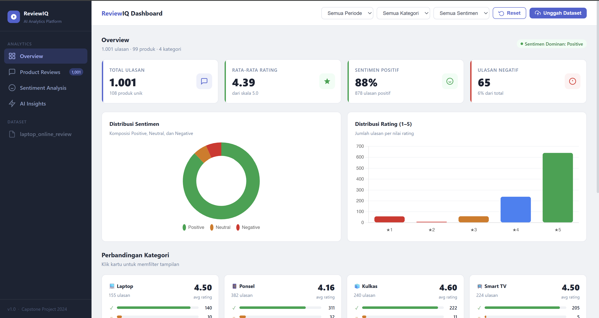
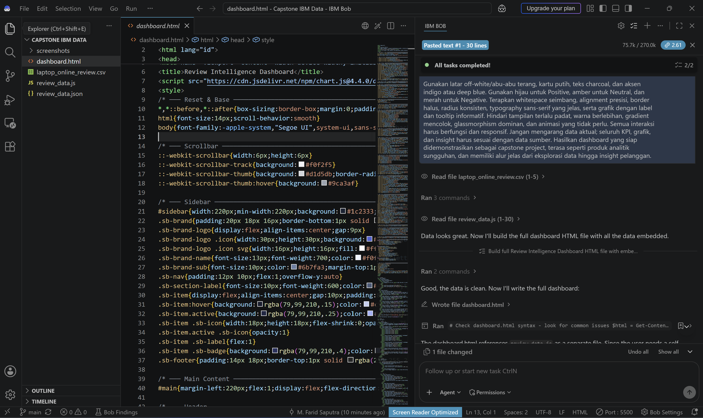

# Review Intelligence

**AI-powered e-commerce review summarization and sentiment analysis**

Review Intelligence is a capstone project that explores how customer reviews can be turned into concise insights for product evaluation and decision-making. The project combines an AI Agent workflow for summarizing review text and classifying sentiment with an interactive dashboard for exploring review data.

## Project Overview

Online stores can accumulate large numbers of customer reviews. Reading every review manually makes it harder to identify recurring feedback, product strengths, and areas that may need improvement. Review Intelligence aims to make this information easier to review by combining text analysis with visual summaries.

## Key Features

- **Review summarization** — generates a concise Indonesian-language summary of customer feedback, highlighting relevant aspects such as product quality, performance, value for money, delivery, packaging, and overall satisfaction.
- **Sentiment classification** — classifies review sentiment as `Positive`, `Neutral`, or `Negative`.
- **Interactive dashboard** — presents review statistics, rating and sentiment distributions, product-category comparisons, and AI insight sections.
- **Review exploration** — supports searching, filtering, sorting, and browsing review records in the dashboard.

> **Implementation note:** The dashboard is a visualization interface for the review dataset. The AI Agent workflow and dashboard are documented as separate parts of this project; do not assume that the dashboard invokes the AI Agent live unless that integration has been implemented in the current version.

## Dashboard Preview

### Dashboard Overview



### AI Agent Test



## Dataset

The dataset file in this repository is `laptop_online_review.csv`. Its main columns are:

| Column | Description |
| --- | --- |
| `Unnamed: 0` | Review row/index identifier |
| `Product_name` | Product name associated with the review |
| `Review` | Customer review text used for analysis |
| `Rating` | Customer rating on a 1–5 scale |

The dashboard also uses the prepared review data files included in the repository. Check the source dataset and data preparation process before interpreting dashboard totals or category-level results.

## Technology Stack

- **HTML, CSS, JavaScript** — dashboard structure, styling, and interactions
- **Chart.js** — charts and data visualization
- **CSV / JSON / JavaScript data files** — review data used by the dashboard
- **IBM Bob** — AI-assisted development and testing workflow for the AI Agent and dashboard

## Getting Started

### 1. Clone the repository

```bash
git clone https://github.com/eferdee/ecommerce-review-analyzer.git
cd ecommerce-review-analyzer
```

### 2. Run the dashboard

Open `dashboard.html` in a modern web browser. For a local HTTP server, run:

```bash
python -m http.server 8000
```

Then open [http://localhost:8000/dashboard.html](http://localhost:8000/dashboard.html).

The dashboard loads Chart.js from a CDN, so an internet connection is required for the chart library to load.

## Repository Structure

```text
ecommerce-review-analyzer/
├── screenshots/
│   ├── ai-agent-test.png
│   └── dashboard-overview.png
├── app.js
├── dashboard.html
├── data.js
├── laptop_online_review.csv
├── README.md
└── styles.css
```

If the dashboard files have been split into separate HTML, CSS, or JavaScript files, update this tree to reflect the current repository structure.

## Current Scope and Limitations

- Dashboard results depend on the dataset and prepared data files in the repository.
- The dashboard is intended to run locally; a hosted live demo is not included here.
- AI-generated summaries and sentiment labels should be checked against the original reviews, especially before making business decisions.
- Automated evaluation of summary quality and sentiment-classification performance can be added in a future iteration.

## Possible Future Improvements

- Integrate the AI Agent directly with the dashboard so users can analyze newly uploaded review datasets.
- Add aspect-based sentiment analysis to distinguish feedback about quality, performance, price, delivery, and other themes.
- Identify recurring complaints and product strengths automatically.
- Evaluate summarization quality and sentiment-classification performance using a documented test set.
- Deploy the dashboard and provide a reproducible data-processing workflow.

## Author

**M. Farid Saputra**

GitHub: [@eferdee](https://github.com/eferdee)
